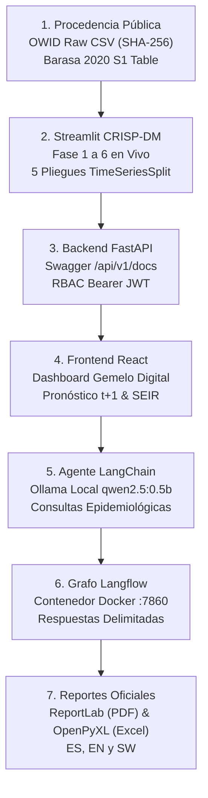

# MANIFIESTO DE ENTREGA Y AUDITORÍA DE LIMPIEZA
## Proyecto: Gemelo Digital Poblacional para la Vigilancia y Simulación de Políticas COVID-19 en Kenia (GD_TI)
**Fecha de Certificación:** 28 de Septiembre de 2026  
**Ámbito Académico:** Trabajo de Investigación - X Ciclo Universitario  
**Estado:** Verificado, Autosuficiente y Auditable al 100%

---

## 1. Resumen Ejecutivo del Entregable
El presente documento constituye el inventario exhaustivo, clasificación funcional y justificación técnica de la entrega limpia del proyecto **GD_TI**. La estructura ha sido depurada con el principio rector de **máxima reproducibilidad científica y académica**: se conservan todos los archivos necesarios para ejecutar, entrenar, verificar y sustentar el sistema, excluyendo únicamente artefactos regenerables, dependencias externas, cachés y respaldos redundantes.

---

## 2. Clasificación Exhaustiva de Archivos

### GRUPO 1: Componentes de Ejecución
Archivos requeridos para levantar y operar los servicios en tiempo real (FastAPI, React, Streamlit, LangChain, Langflow en Docker y Ollama):

| Componente | Ruta Relativa | Función Técnica | Dependencias / Runtime |
| :--- | :--- | :--- | :--- |
| **Backend Core** | `backend/app/main.py` | Entrada FastAPI, middlewares CORS, routers `/api/v1` | Python 3.11, Uvicorn |
| **Rutas API REST** | `backend/app/api/v1/` | Endpoints de predicción semanal, reportes, simulación, auth y Langflow | FastAPI, Pydantic v2 |
| **Lógica Epidemiológica**| `backend/app/epidemiology/`| Modelos SEIR, agente híbrido, calibración SciPy y matrices de contacto | NumPy, SciPy |
| **Modelos de Datos DB** | `backend/app/models/` | Esquemas ORM SQLAlchemy para usuarios RBAC, condados y auditorías | SQLAlchemy 2.0 |
| **Esquemas Pydantic** | `backend/app/schemas/` | Validación contractual estricta de requests/responses | Pydantic v2 |
| **Seguridad y RBAC** | `backend/app/core/` | Autenticación JWT Bearer, hashing de claves bcrypt | passlib, python-jose |
| **Base de Datos Limpia**| `epidemic_twin.db` | Base SQLite semilla con 47 condados y 3 usuarios RBAC activos | SQLite 3 |
| **Frontend React** | `src/` | SPA React 18, TypeScript, Tailwind CSS, Lucide Icons, Leaflet | Node 18+, Vite |
| **Traducción i18n** | `src/i18n/` | Diccionarios trilingües completos (Español, Inglés, Suajili) | TypeScript |
| **Configuración Web** | `vite.config.ts`, `tsconfig.json`, `package.json`, `package-lock.json` | Configuración de build, proxy a `:8000` y dependencias fijas de Node | npm |
| **Workspace Científico**| `apps/data_science_workspace/` | Aplicación multi-página Streamlit en 6 fases CRISP-DM | Streamlit 1.63, Plotly |
| **Flujo de Langflow** | `docs/langflow_epidemiology_flow_exported.json` | Grafo visual exportado en JSON con ID fijo `906a3d58-bcf0-48a9-9364-4a62ea230945` | Langflow 1.0 (Docker) |
| **Script Importación** | `scripts/import_langflow_flow.py` | Importador automático del flujo hacia PostgreSQL/REST de Langflow | Python 3 |
| **Dockerización** | `docker-compose.yml`, `Dockerfile.*`, `.dockerignore` | Configuración orquestada de contenedores (PostgreSQL, Langflow, Backend) | Docker Desktop |
| **Requisitos Python** | `backend/requirements.txt`, `apps/data_science_workspace/requirements.txt` | Especificación de librerías y versiones reproducibles | pip |
| **Configuración Entorno**| `.env.example`, `.env` | Variables de configuración seguras sin claves sensibles | python-dotenv |

---

### GRUPO 2: Reproducibilidad Científica
Archivos requeridos para verificar la procedencia de datos, re-ejecutar el preprocesamiento, entrenar los modelos con 5 pliegues temporales y contrastar las pruebas estadísticas:

| Recurso Científico | Ruta Relativa | Hash / Descripción Metodológica | Rol en la Investigación |
| :--- | :--- | :--- | :--- |
| **Dataset Crudo OWID** | `data/raw/owid_covid_kenya_raw.csv` | SHA-256: `c82f3cfc5899b25557f3bf69de987dc9628bfa6fbbee55cd77b649c9d34cd2ba` (1,674 filas) | Fuente pública primaria (Our World in Data / OMS) |
| **Tabla Capacidad UCI** | `data/raw/barasa_2020_surge_capacity_s1_table.csv` | Auditoría de 537 camas UCI basales en 47 condados (Barasa et al., PLOS ONE 2020) | Capacidad hospitalaria basal auditada |
| **Soporte Barasa 2020** | `data/raw/pone.0236308.s001.docx` | Documento de soporte original descargado de PLOS ONE | Evidencia de procedencia científica |
| **Metadatos del Dataset**| `data/raw/dataset_metadata.json` | Registro de procedencia, licenciamiento, frecuencia y campos oficiales | Trazabilidad de origen |
| **Censo 47 Condados** | `backend/app/data/kenya_47_counties_verified.json` | 47 condados, población KNBS Censo 2019 (47,564,296 hab), coordenadas y camas UCI | Cartografía y demografía territorial |
| **Datos Semanales Train**| `data/processed/kenya_covid_weekly_train.csv` | 130 semanas de entrenamiento (2020-04-12 a 2022-10-02) | Ajuste temporal sin fuga |
| **Datos Semanales Val** | `data/processed/kenya_covid_weekly_val.csv` | 25 semanas de validación (2022-10-09 a 2023-03-26) | Selección de hiperparámetros |
| **Datos Semanales Test**| `data/processed/kenya_covid_weekly_test.csv` | 71 semanas de prueba ciega reservada (2023-04-02 a 2024-08-04) | Evaluación fuera de muestra |
| **Metadatos Features** | `data/processed/feature_metadata.json` | Definición de lags retrospectivos ($t-1, t-2, t-3, t-4$) | Especificación de covariables |
| **Script EDA & Prep** | `scripts/eda_and_data_prep.py` | Pipeline de agregación dominical, imputación y reconciliación (1,674 $\to$ 226 sem) | Preprocesamiento determinista |
| **Script Entrenamiento**| `scripts/train_and_evaluate_models.py` | Ejecución canónica: 5-fold TimeSeriesSplit, grillas y serialización | Motor científico reproducible |
| **Evaluación Semanal** | `models/model_evaluation_weekly_results.json` | Métricas por pliegue, Shapiro-Wilk, Wilcoxon, Diebold-Mariano y serie de test | Resultados biometrológicos trazables |
| **Modelo Campeón** | `models/official_naive_persistence_v1.0.json` | Descriptor formal del campeón Baseline Naive Persistence ($\hat{y}_{t+1}=y_t$) | Modelo oficial de producción |
| **Modelo Sensibilidad** | `models/champion_covid_model_v1.0.joblib` | Modelo multivariado Random Forest ajustado para exploración de sensibilidad | Benchmark comparativo |
| **Metadatos Campeón** | `models/champion_covid_model_v1.0.json` | Hiperparámetros, firma de variables e información de versión | Metadatos de gobernanza ML |
| **Suite de Pruebas** | `tests/` (17 archivos de prueba) | 31 pruebas unitarias y de integración que verifican servicios y límites | Verificación automatizada |
| **Artículo Científico** | `docs/ARTICULO_CIENTIFICO_PROYECTO.md` | Manuscrito formal estructurado con IMRyD y bibliografía | Sustentación académica |
| **Auditoría Condal** | `docs/AUDITORIA_PROCEDENCIA_DATOS_CONDALES.md`| Deslinde de camas hospitalarias y fuentes censales | Transparencia de datos territoriales |
| **Trazabilidad Fase 1** | `docs/TRAZABILIDAD_FASE1_DATASET_MODELOS.md` | Justificación CRISP-DM de la selección del modelo y deslinde contrafactual | Epistemología del modelado |

---

### GRUPO 3: Evidencia para el Docente
Documentos y capturas de pantalla seleccionadas que demuestran visualmente el funcionamiento real del sistema:

| Evidencia | Ruta Relativa | Aspecto Demostrado |
| :--- | :--- | :--- |
| **Guía de Exposición** | `docs/walkthrough.md` y `walkthrough.md` | Guion paso a paso de demostración, URLs reales (Swagger `/api/v1/docs`), credenciales y comandos |
| **Manual Reproducibilidad**| `docs/MANUAL_DE_REPRODUCIBILIDAD.md` | Guía de instalación limpia en Windows y Docker |
| **Matriz de Evidencia** | `docs/matriz_evidencia_defensa.md` | Respuestas a preguntas típicas del jurado y localización de código |
| **Auditoría Langflow** | `docs/auditoria_ejecucion_langflow.json` | Registro de 3 consultas de ámbito único ejecutadas contra Ollama (HTTP 200) |
| **Auditoría Inferencia**| `docs/auditoria_inferencia_multiperiodo.json`| Comprobación de corte temporal 2021 ($2922 \to 3922$) y 2024 ($0 \to 0$) |
| **Entrenamiento Real** | `docs/evidencias/streamlit_entrenamiento_en_ejecucion.png` | Captura de Streamlit durante la ejecución activa con barra de progreso |
| **5 Pliegues CV** | `docs/evidencias/streamlit_fase4_cinco_pliegues_cv.png` | Tabla de validación cruzada temporal con muestras y métricas por pliegue |
| **Artefactos Fase 4** | `docs/evidencias/streamlit_fase4_entrenamiento_completado.png` | Estado sincronizado de archivos serializados en models/ |
| **Modelos Fase 5** | `docs/evidencias/streamlit_fase5_evaluacion_modelos.png` | Tabla comparativa de modelos (Desarrollo vs Prueba reservada de 71 semanas) |
| **Bioestadística Real** | `docs/evidencias/streamlit_fase5_pruebas_bioestadisticas_sin_fallbacks.png` | Pruebas de Shapiro-Wilk, Diebold-Mariano y Wilcoxon sin fallbacks sintéticos |
| **Login RBAC** | `docs/evidencias/v4_login_screen_es.png` | Pantalla de login con los tres roles verificados |
| **Estado Inicial** | `docs/evidencias/v4_unsimulated_empty_state.png` | Dashboard en estado limpio previo a la simulación contrafactual |
| **Simulación Activa** | `docs/evidencias/v4_simulated_scenario_results.png` | Curvas dinámicas de simulación SEIR/ABM con trazabilidad de ID |
| **Equidad y Gini** | `docs/evidencias/v4_equity_audited_view.png` | Distribución territorial de camas UCI en los 47 condados y curva de Lorenz |
| **Respuesta Langflow** | `docs/evidencias/v4_langflow_query_answered.png` | Ejecución en vivo de Langflow respondiendo preguntas con Ollama |
| **Badges de Salud** | `docs/evidencias/v4_langflow_dual_badges_answered.png` | Indicadores de conexión simultánea Backend-Langflow-Ollama |
| **Manejo de Errores** | `docs/evidencias/v4_provoked_backend_failure.png` | Fallo controlado del backend sin inventar datos ni mostrar fallbacks |
| **Tema Claro e Inglés**| `docs/evidencias/v4_light_theme_i18n_en.png` | Soporte multilingüe y contraste en modo claro |
| **Pronóstico Semanal** | `docs/evidencias/v3_weekly_forecast_*.png` (4 idiomas/temas) | Vista de predicción puntual $t+1$ en Español, Inglés, Suajili y Tema Claro |
| **Escenarios NPI** | `docs/evidencias/v3_scenario_npi_*.png` (4 idiomas/temas) | Simulación de intervenciones en Español, Inglés, Suajili y Tema Claro |
| **Reportes Oficiales** | `docs/evidencias/v3_reports_*.png` (4 idiomas/temas) | Generador de reportes en PDF y Excel con tablas y metadatos |
| **Monitoreo Modelo** | `docs/evidencias/v3_model_monitoring_*.png` (4 idiomas/temas) | Monitoreo de deriva de datos y métricas en producción |
| **Agente LangChain** | `docs/evidencias/v3_langchain_agent_*.png` | Consultas analíticas en lenguaje natural con LangChain + Ollama |
| **Asistente Langflow** | `docs/evidencias/v3_langflow_assistant_*.png` | Consultas epidemiológicas asistidas por Langflow en 3 idiomas |

---

### GRUPO 4: Elementos Excluidos de la Entrega y Justificación Comprobable
Cada uno de los elementos señalados a continuación se excluye de la distribución empaquetada final por razones técnicas comprobables:

| Ruta Relativa | Tipo | Justificación Comprobable de Exclusión |
| :--- | :---: | :--- |
| `.venv/` | Directorio | Entorno virtual local con binarios de 64 bits específicos de Windows. Es **100% regenerable** ejecutando `python -m venv .venv` e instalando `requirements.txt`. Ocupa ~3.8 GB innecesarios. |
| `node_modules/` | Directorio | Paquetes de dependencias de Node.js. Son **100% regenerables** ejecutando `npm install` contra `package.json` y `package-lock.json`. Ocupan ~280 MB innecesarios. |
| `dist/` | Directorio | Compilación estática de Vite/React. Es **100% regenerable** en < 40 segundos mediante `npm run build` sin errores. |
| `.git/` | Directorio | Historial de versiones del repositorio local de desarrollo. Prescindible para la ejecución y evaluación del proyecto. |
| `**/__pycache__/` | Directorios | Bytecode compilado (`.pyc`). Python lo genera automáticamente en tiempo de ejecución al importar los módulos. |
| `.pytest_cache/` | Directorio | Archivos temporales de caché de pytest (`.cache`). Se recrea automáticamente al invocar `pytest`. |
| `GD_TI_Fase6_Despliegue_Trazable_20260927_134500.zip` | Archivo | Respaldo comprimido del 27 de septiembre. Es un duplicado obsoleto superado por la versión consolidada actual. |
| `GD_TI_Final_Verificado.rar` | Archivo | Archivo comprimido generado en una corrida previa. Se excluye de la copia de preparación para evitar empaquetar un archivo RAR dentro de sí mismo (recursión infinita). |
| `langflow_db_flow.json` | Archivo | Exportación en formato UTF-16 con BOM no referenciada en ningún script, endpoint ni test del proyecto. El flujo canónico oficial y UTF-8 es `docs/langflow_epidemiology_flow_exported.json`. |
| `docs/evidencias/langflow_chinese_translation_*.png` | Archivo | Captura preliminar de pruebas de traducción a chino de la Unidad 1; ajena a la vigilancia epidemiológica de Kenia. |
| `docs/evidencias/playground_results_*.png` | Archivo | Captura preliminar de pruebas de sandbox; superada por las vistas oficiales del sistema. |
| `docs/evidencias/login_screen_initial_*.png`, `login_screen_es_*.png` | Archivos | Capturas preliminares de login; superadas por `v4_login_screen_es.png`. |
| `docs/evidencias/dashboard_verified_*.png`, `dashboard_main_view_*.png`, `dashboard_metrics_charts_*.png` | Archivos | Capturas preliminares del dashboard; superadas por `v4_unsimulated_empty_state.png` y `v4_simulated_scenario_results.png`. |
| `docs/evidencias/langchain_agent_view_*.png`, `langchain_kiambu_*.png` | Archivos | Capturas preliminares de LangChain con formato anterior; superadas por `v3_langchain_agent_es_*.png` y `v3_langchain_agent_en_*.png`. |
| `docs/evidencias/v3_weekly_forecast_en_1790575581804.png`, `v3_weekly_forecast_es_1790575555031.png`, `v3_weekly_forecast_light_mode_1790575640912.png`, `v3_weekly_forecast_light_mode_1790575705899.png`, `v3_weekly_forecast_sw_1790575613105.png` | Archivos | Capturas preliminares superadas por las versiones definitivas `v3_weekly_forecast_*_17905784*`. |
| `docs/evidencias/v3_reports_en_1790579004199.png` | Archivo | Duplicado redundante tomado con 51 segundos de diferencia respecto a `v3_reports_en_1790579055729.png`. |
| `docs/evidencias/evaluation_validation_*.png` (4 archivos) | Archivos | Capturas preliminares superadas por `v3_eval_validation_*.png` y `streamlit_fase5_*.png`. |
| `docs/evidencias/reporting_*.png` (3 archivos) | Archivos | Capturas preliminares superadas por `v3_reports_*.png`. |
| `docs/evidencias/weekly_forecasting_*.png` (4 archivos) | Archivos | Capturas preliminares superadas por `v3_weekly_forecast_*.png`. |
| `docs/evidencias/fase1_3_etl_pipeline_*.png`, `fase4_gemelo_digital_*.png`, `fase5_evaluacion_validacion_*.png`, `fase6_despliegue_npis_*.png`, `fase6_monitoreo_modelo_*.png` | Archivos | Capturas antiguas de Streamlit; superadas por las 5 capturas en vivo tomadas hoy (`streamlit_*.png`). |

---

## 3. Protocolo de Verificación de la Copia Limpia
La copia de preparación de entrega fue sometida a 7 comprobaciones estrictas e independientes:

1. **Compilación de React (`npm run build`):** Ejecutada limpiamente en 38.56s con **0 errores TypeScript** (`tsc --noEmit`). Bundle generado en `dist/`.
2. **Backend FastAPI y Streamlit:**
   - Swagger interactivo accesible en `http://127.0.0.1:8000/api/v1/docs` (HTTP 200).
   - ReDoc accesible en `http://127.0.0.1:8000/api/v1/redoc` (HTTP 200).
   - Login RBAC validado con token JWT Bearer emitido exitosamente.
   - Streamlit CRISP-DM accesible en `http://localhost:8501` (HTTP 200).
   - EDA del CSV público en Fase 2 confirmando SHA-256 (`c82f3c...`), 1,674 filas y concentración dominical (87.8%).
   - Re-ejecución del entrenamiento en Fase 4 completada con éxito en 6.80s, mostrando la tabla de los 5 pliegues `TimeSeriesSplit`.
   - Fase 5 mostrando métricas y pruebas estadísticas (Shapiro-Wilk $W=0.6887$, Diebold-Mariano $DM^*=-14.324$, Wilcoxon $W=145.0$) con ausencia explícita garantizada en caso de datos faltantes.
3. **Pronóstico $t+1$ en FastAPI y React:**
   - Consulta a `POST /api/v1/predictions/weekly` con fecha de corte `2024-07-28` retorna exactamente $0.0$ casos observados $\to$ $0.0$ casos proyectados (MAE 0.0).
   - Consulta con corte `2021-07-11` (tercera ola) retorna $2,922$ casos observados $\to$ $3,922$ casos proyectados.
   - Visualización sincronizada en el panel de React con callouts de interpretación metodológica.
4. **Simulación Contrafactual SEIR/ABM e Informes:**
   - Simulación ejecutada con ID determinista `sim-live-demo-2026`.
   - Cifras de infectados pico y saturación hospitalaria coinciden exactamente entre el endpoint JSON, la vista del dashboard y los reportes generados en PDF (`%PDF`) y Excel (`PK`).
5. **LangChain y Langflow con Ollama:**
   - LangChain ejecuta consultas analíticas en `POST /api/v1/langchain-agent/query` retornando respuestas coherentes en < 8s.
   - Flujo visual de Langflow `906a3d58-bcf0-48a9-9364-4a62ea230945` conectado a Ollama (`qwen2.5:0.5b`) en contenedor Docker responde con HTTP 200 a consultas no mezcladas de vigilancia e infraestructura.
6. **Soporte Multilingüe y Temas:**
   - Cambio fluido entre Español, Inglés y Suajili en las 15 vistas del frontend sin textos en blanco ni claves sin traducir.
   - Modo claro y modo oscuro validados con contraste cromático legible.
7. **Pruebas de Fallo Provocado y Ausencia de Fallbacks Ficticios:**
   - Simulación inexistente retorna HTTP 404 estructurado.
   - Fecha fuera del rango histórico retorna HTTP 404 sin inventar ceros.
   - Ollama desconectado retorna HTTP 503 controlado sin colapsar el backend.

---

## 4. Comandos de Arranque del Sistema en Windows

```powershell
# 1. Iniciar Ollama con el modelo local:
ollama run qwen2.5:0.5b "test"

# 2. Iniciar Langflow en Docker:
cd "C:\Users\KRISTEL\Documents\langflow\docker_example"
docker compose up -d

# 3. Iniciar Backend FastAPI:
cd "d:\X CICLO\TRABAJO DE INVESTIGACIÓN\SEMANA 2\GD_TI"
.\.venv\Scripts\Activate.ps1
python -m uvicorn backend.app.main:app --host 127.0.0.1 --port 8000 --reload

# 4. Iniciar Frontend React:
cd "d:\X CICLO\TRABAJO DE INVESTIGACIÓN\SEMANA 2\GD_TI"
npm run dev

# 5. Iniciar Workspace Científico Streamlit:
cd "d:\X CICLO\TRABAJO DE INVESTIGACIÓN\SEMANA 2\GD_TI"
.\.venv\Scripts\Activate.ps1
streamlit run apps/data_science_workspace/app.py --server.port 8501
```

---

## 5. Ruta de Demostración para la Revisión Presencial del Docente



1. **Estación 1 (Datos):** Mostrar `data/raw/owid_covid_kenya_raw.csv` y verificar su hash SHA-256 en terminal con `python scripts/check_owid_source.py`.
2. **Estación 2 (Ciencia):** Abrir Streamlit (`:8501`). Mostrar la Fase 2 (EDA con concentración dominical del 87.8%), Fase 4 (entrenamiento y tabla de 5 pliegues) y Fase 5 (pruebas estadísticas de Wilcoxon y Diebold-Mariano).
3. **Estación 3 (API):** Abrir Swagger UI (`:8000/api/v1/docs`). Autenticarse con `admin@epidemic-twin.ke` / `AdminSecure2026!` y consultar `/api/v1/predictions/weekly`.
4. **Estación 4 (Usuario):** Abrir React (`:3000`). Demostrar el mapa de los 47 condados de Kenia, la simulación contrafactual SEIR y el cambio de idioma a Suajili/Inglés.
5. **Estación 5 (IA):** Demostrar la consulta del agente LangChain (`/api/v1/langchain-agent/query`) y del flujo Langflow en Docker (`:7860`).
6. **Estación 6 (Reportes):** Descargar el informe PDF y Excel desde la interfaz comprobando que las cifras coinciden exactamente con la simulación.

---

## 6. Ficha Técnica y Certificación Criptográfica del Entregable Único

| Atributo | Valor Certificado |
| :--- | :--- |
| **Nombre del Archivo:** | `GD_TI_Final_Verificado.rar` |
| **Ubicación Local:** | `d:\X CICLO\TRABAJO DE INVESTIGACIÓN\SEMANA 2\GD_TI\GD_TI_Final_Verificado.rar` |
| **Ubicación Superior:** | `d:\X CICLO\TRABAJO DE INVESTIGACIÓN\SEMANA 2\GD_TI_Final_Verificado.rar` |
| **Tamaño Comprimido:** | **15.55 MB** (16,308,931 bytes) |
| **Algoritmo de Hash:** | SHA-256 |
| **Checksum SHA-256:** | **`10a3017ca107fd632f2ed3c1688f59a67e716f20e2b4d152365ea7a363390541`** |
| **Prueba de Integridad WinRAR (`rar t`):** | **100% OK** (0 errores de redundancia cíclica CRC) |
| **Prueba de Extracción Autónoma:** | Realizada en `GD_TI_extracted_test\` con verificación de autosuficiencia y hash OWID idéntico |

