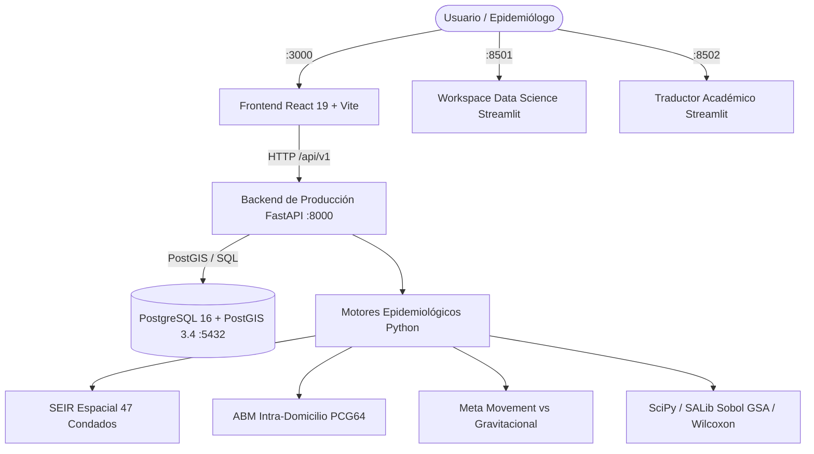

# Manual de Reproducibilidad y Arquitectura Científica
## Population-Level Digital Twin (Kenia - 47 Condados)

Este documento detalla la arquitectura, metodología científica, despliegue y procedimientos de verificación para el sistema integral de Gemelo Digital Epidemiológico de Kenia.

---

## 1. Arquitectura del Sistema y Puertos de Producción

La solución está desacoplada en microservicios contenerizados orquestados mediante `docker-compose.yml`:



### Distribución de Puertos Oficiales
| Servicio | Tecnología | Puerto | Descripción |
|---|---|---|---|
| **Base de Datos Espacial** | PostgreSQL 16 + PostGIS 3.4 | `:5432` | 47 condados con geometrías poligonales EPSG:4326, KNBS 2019, KDHS 2022 y KMFL |
| **Backend Único de Producción** | Python 3.11 + FastAPI + Uvicorn | `:8000` | Todas las rutas bajo prefijo `/api/v1`, OpenAPI docs en `/api/v1/docs` |
| **Frontend Web de Producción** | React 19 + Vite + TailwindCSS v4 | `:3000` | UI de toma de decisiones, visualización 3D y chatbot flotante |
| **Workspace Data Science** | Python 3.11 + Streamlit | `:8501` | Entorno CRISP-DM (Fases 1 a 5), calibración SciPy, SALib y aprobación técnica |
| **Traductor Académico Satélite** | Python 3.11 + Streamlit + LangChain | `:8502` | Pipeline multi-agente para traducción científica de artículos |

---

## 2. Requisitos Previos

- **Docker y Docker Compose**: Docker Engine 24.0+ y Docker Compose v2.20+
- *(Para ejecución Bare-Metal local opcional)*:
  - Python 3.11+ con `pip` y `virtualenv`
  - Node.js 20+ y `npm`
  - PostgreSQL 16 con extensión PostGIS instalada

---

## 3. Configuración del Entorno (.env)

Cree un archivo `.env` en la raíz del proyecto basándose en `.env.example`:

```bash
# Servidor y Base de Datos
POSTGRES_USER=epidemic_admin
POSTGRES_PASSWORD=KenyaPostgisSecure2026!
POSTGRES_DB=epidemic_twin_ke
DATABASE_URL=postgresql://epidemic_admin:KenyaPostgisSecure2026!@db:5432/epidemic_twin_ke

# Seguridad JWT y RBAC
SECRET_KEY=k3ny4_3p1d3m1c_tw1n_s3cur3_jwt_k3y_pr0duct10n_2026_g00gl3
ALGORITHM=HS256
ACCESS_TOKEN_EXPIRE_MINUTES=480

# Inteligencia Artificial Local (Ollama)
OLLAMA_BASE_URL=http://127.0.0.1:11434
OLLAMA_MODEL=qwen2.5:0.5b
OLLAMA_TIMEOUT_SECONDS=60

# Restricciones de Seguridad de Archivos
MAX_FILE_SIZE_MB=15
MAX_BATCH_SIZE_MB=100
MAX_BATCH_FILES=10
```

---

## 4. Despliegue en Producción (Modo Recomendado: Docker Compose)

Para compilar y levantar todos los servicios en sus puertos correspondientes en una instalación limpia desde cero:

```bash
# 1. Limpieza total de contenedores y volúmenes previos (Instalación limpia verificable)
docker compose down -v

# 2. Compilar y levantar contenedores en segundo plano
docker compose up -d --build

# 3. Verificar estado de salud de los contenedores
docker compose ps

# 4. Sembrar datos verificados e inicializar esquema relacional
docker compose exec backend python backend/app/scripts/seed_verified_data.py

# 5. Importar y fijar el flujo epidemiológico en Langflow (Ollama local qwen2.5:0.5b)
# Ejecuta script de importación con API key y fija LANGFLOW_FLOW_ID=906a3d58-bcf0-48a9-9364-4a62ea230945
python scripts/import_langflow_flow.py
# (Alternativa vía API del backend):
# curl -X POST http://localhost:8000/api/v1/langflow/import-flow
```

### Configuración de Red Docker y URL Interna de Langflow
- Dentro de la red interna Docker (`epidemic_network`), FastAPI se comunica con Langflow mediante `http://langflow:7860`.
- Fuera de la red Docker (acceso de navegador o bare-metal), Langflow responde en `http://localhost:7860`.
- El endpoint `GET /api/v1/langflow/status` reporta dos dimensiones independientes:
  1. `service_available: true/false` (disponibilidad HTTP del puerto 7860).
  2. `flow_imported: true/false` (presencia efectiva del flujo `906a3d58-bcf0-48a9-9364-4a62ea230945` verificado en la base o REST API).
- En la interfaz React, se visualizan dos badges diferenciados: **«Servicio :7860: ONLINE/OFFLINE»** y **«Flujo: IMPORTADO Y EJECUTADO / PENDIENTE DE IMPORTACIÓN»**, garantizando que un simple "ping" nunca se confunda con la ejecución real del flujo epidemiológico.

Acceso a las aplicaciones:
- **Frontend Principal**: [http://localhost:3000](http://localhost:3000)
- **FastAPI OpenAPI Docs**: [http://localhost:8000/api/v1/docs](http://localhost:8000/api/v1/docs)
- **Langflow UI**: [http://localhost:7860](http://localhost:7860)
- **Data Science Workspace**: [http://localhost:8501](http://localhost:8501)
- **Traductor Académico**: [http://localhost:8502](http://localhost:8502)

---

## 5. Despliegue Bare-Metal Local (Desarrollo sin Docker)

### Paso 1: Dependencias y Backend FastAPI
```bash
pip install -r backend/requirements.txt
python backend/app/scripts/seed_verified_data.py
python -m uvicorn backend.main:app --host 0.0.0.0 --port 8000 --reload
```

### Paso 2: Frontend React 19 + Vite
```bash
npm install
npm run build
npm run dev -- --port 3000
```

### Paso 3: Data Science Workspace
```bash
pip install -r apps/data_science_workspace/requirements.txt
streamlit run apps/data_science_workspace/app.py --server.port 8501
```

### Paso 4: Traductor Académico
```bash
pip install -r apps/academic_translator/requirements.txt
streamlit run apps/academic_translator/app.py --server.port 8502
```

---

## 6. Credenciales Oficiales de Demostración (RBAC)

| Rol | Correo Electrónico | Contraseña | Permisos y Alcance |
|---|---|---|---|
| **Administrador** | `admin@epidemic-twin.ke` | `AdminSecure2026!` | Acceso irrestricto, CRUD de usuarios, bitácora de auditoría, aprobación técnica |
| **Epidemiólogo** | `dr.wanjiku@health.go.ke` | `EpiChief2026!` | Calibración SciPy, simulación NPI, evaluación H1, aprobación técnica |
| **Analista** | `omondi@moh.go.ke` | `AnalystMOH2026!` | Ejecución de escenarios, comparativa, exportación de informes PDF/Excel |

---

## 7. Principios Científicos y Restricciones Metodológicas

1. **Datos Oficiales de los 47 Condados**:
   - Poblaciones oficiales del Censo KNBS 2019.
   - Quintiles socioeconómicos KDHS 2022 ($Q_1$ más pobre a $Q_5$ más rico) con suma unitaria estricta ($\sum Q_i = 1.0$).
   - Camas UCI oficiales del KMFL. Donde no existe registro oficial verificado, el valor es estrictamente `null`. **No se inventan cifras.**

2. **Modelado de Movilidad Condal**:
   - `Modelo Gravitacional Estimado`: Estimación matemática basada en distancias geodésicas (Haversine) y masas poblacionales KNBS 2019 implementado en `backend/app/epidemiology/mobility_engine.py`. Al no disponer de microdatos de telemetría celular Meta Data for Good en el repositorio, se eliminaron formalmente todas las declaraciones sobre ingesta empírica de Meta, clasificando la matriz inter-condal como una estimación gravitacional reproducible.
   - Cuando se evalúan escenarios, se inyecta la advertencia en pantalla e informes:
     > **"MODELO GRAVITACIONAL ESTIMADO – SIMULACIÓN MATEMÁTICA PROSPECTIVA"**

3. **Contraste Riguroso de la Hipótesis H1**:
   - Criterio de Aceptación:
     $$\Delta \text{MAPE}_{pp} = \text{MAPE}_{\text{SEIR Clásico}} - \text{MAPE}_{\text{Gemelo Digital}} \ge 15.0\text{ puntos porcentuales}$$
     $$\text{Wilcoxon Signed-Rank } p < 0.05$$
   - Si se introducen datos sintéticos, el evaluador responde inmediatamente con estado `BLOCKED_SYNTHETIC` y `h1_supported = False`.

4. **Compuerta de Aprobación Técnica del Modelo**:
   - Requisitos obligatorios: Cobertura de datos $\ge 80\%$, $R^2 \ge 0.80$, y datos 100% empíricos (`is_synthetic = False`).
   - Al aprobarse, genera un artefacto versionado JSON con firma hash **SHA-256**, registrado sin serialización `pickle` insegura.

5. **Validación Externa (2023–2024)**:
   - Si los microdatos del Ministerio de Salud (MOH) no están cargados en el repositorio, la API responde explícitamente `status: "PENDING"`, con métricas nulas.

6. **Copiloto Epidemiológico IA, LangChain, Langflow y Traductor con Ollama Local**:
   - Se eliminaron todos los textos simulados, fallbacks o de relleno.
   - Toda la arquitectura opera 100% de manera local con Ollama (`qwen2.5:0.5b`). No se requieren claves externas de API (Google Gemini).
   - Si Ollama o Langflow no están en ejecución o son inaccesibles, el backend responde con código `HTTP 503` y mensaje explícito de indisponibilidad sin caídas del servidor.
   - La interfaz React tiene como **único punto de entrada** el botón flotante en la esquina inferior derecha y las vistas dedicadas en el menú lateral.

7. **Seguridad en Procesamiento de Archivos (Traductor)**:
   - Validación MIME por números mágicos (`application/pdf`, `text/markdown`, `text/plain`).
   - Límite estricto de 15 MB por archivo y 100 MB por lote (máximo 10 archivos).
   - Bloqueo de path traversal y ratio de compresión anti zip-bomb ($>10:1$).

8. **Prohibición Absoluta de Objetos Iniciales y Cifras Ficticias (Estado Nulo en UI)**:
   - En `src/App.tsx` y vistas dependientes (`DashboardView`, `SensitivityView`, `EquityView`, `ScenarioComparator`), el estado inicial es estrictamente `simResult = null`.
   - No se presentan 0 casos, 450 camas UCI, población fija o «Within safe surge limits» como si fuesen cálculos epidemiológicos.
   - Las tarjetas no ejecutadas muestran `—` con el rótulo explícito **«Ejecute una simulación»**.
   - En caso de fallo de `/api/v1/simulations/run` (ej. backend apagado al entrar), la interfaz conserva el error en un banner persistente visible con opción de reintentar.
   - En Equidad y Sensibilidad, se eliminó la cifra no respaldada `Observed DHS: 0.58x` y el cálculo de "brecha evitada"; el análisis de equidad se evalúa rigurosamente contra la regla del 80% ($[0.80x, 1.20x]$) de `backend/app/analytics/equity.py`.

---

## 8. Ejecución Automatizada de Pruebas

Para ejecutar la batería completa de 34 pruebas unitarias, verificación estricta de TypeScript y compilación de producción:

```powershell
powershell -ExecutionPolicy Bypass -File scripts/run_all_tests.ps1
```

O de manera individual:
```bash
# 1. Pruebas espaciales PostGIS (47 condados, distancias geodésicas, quintiles DHS)
python -m unittest tests/test_postgis_real.py

# 2. Pruebas de motores epidemiológicos y bioestadística (SEIR, ABM, Sobol, H1, DALYs, DPR)
python -m unittest tests/test_epidemiology_python.py

# 3. Pruebas de API v1 FastAPI (JWT, RBAC, auditoría, exportación PDF/Excel)
python -m unittest tests/test_fastapi_v1_api.py

# 4. Pruebas del Traductor Académico (MIME magic, anti-zip bomb, anti-path traversal)
python -m unittest tests/test_academic_translator.py

# 5. Prueba End-to-End integral del flujo completo
python -m unittest tests/test_e2e_full_flow.py

# 6. Comprobación de tipos en Frontend
npx tsc --noEmit

# 7. Compilación de producción
npm run build
```
